  <picture>
    <source media="(prefers-color-scheme: dark)" srcset="./assets/banner-dark.svg">
    <source media="(prefers-color-scheme: light)" srcset="./assets/banner-light.svg">
    
  </picture>

Desenvolvedor full stack em Maringá, Paraná. Escrevo o software inteiro, da interface ao servidor, e cuido do que vem depois dele: empacotamento, pipeline, deploy e publicação em loja.

## Trajetória

De 2018 a 2025 fui motorista profissional. Entre 2021 e 2024 cursei Sistemas para Internet na UniCesumar, estudando e programando. Desde maio de 2025 me dedico ao desenvolvimento, com alguns freelas pontuais.

## Alguns projetos publicados recentemente

### Anchor Downloader
[Snap Store](https://snapcraft.io/anchor-downloader) · [código](https://github.com/LeandroDukievicz/anchor-downloader)

Gerenciador de downloads do Telegram em interface de terminal. Um broker próprio em socket `AF_UNIX` compartilha uma única conexão entre várias janelas, com limite de taxa global. Os downloads rodam em paralelo e retomam arquivos parciais. Empacotado em snap com confinamento strict e publicado por pipeline no GitHub Actions.

Cerca de 4.200 linhas, com suíte de testes dedicada a path traversal e permissão de arquivo.

`Python` `Textual` `asyncio`

### Devs à Deriva
[devsaderiva.com.br](https://devsaderiva.com.br) · [código](https://github.com/LeandroDukievicz/devs-a-deriva)

Blog técnico próprio, do texto à infraestrutura. Astro com renderização no servidor, painel de publicação separado e mídia em object storage. Nada vai ao ar sem passar pelo pipeline: lint, typecheck, testes, auditoria de segurança, SEO e checagem de link quebrado.

`Astro` `TypeScript` `Docker` `GitHub Actions`

### Ferramentas para Linux

O fabricante só entrega software para Windows. Para não precisar de dual boot só para controlar alguns detalhes da máquina, desenvolvi do zero, por engenharia reversa:

- controle de RGB e refrigeração para notebooks Acer Predator, em GTK4 e libadwaita;
- painel para teclado mecânico com matriz de LED 65x5, falando HID direto;
- módulo DKMS para o kernel.

`GTK4` `libadwaita` `HID` `DKMS`

### Dukie Tech
[techdukie.com.br](https://techdukie.com.br)

Minha operação de desenvolvimento sob medida para pequenas e médias empresas.

Outros projetos

**Cardápio e pedidos em PHP.** Selecionado entre os 10 finalistas do Desafio Nacional UniCesumar, avaliado entre milhares de projetos do país.

**Código aberto.** Contribuições em projetos de terceiros: [Rede-ENois/enois-frontend#102](https://github.com/Rede-ENois/enois-frontend/pull/102), [JafarAkhondali/acer-predator-turbo-and-rgb-keyboard-linux-module#308](https://github.com/JafarAkhondali/acer-predator-turbo-and-rgb-keyboard-linux-module/pull/308)

## Stack

Na ordem em que aparece no trabalho.

**Produto** 
`TypeScript` `React` `Next.js` `Astro` `JavaScript` `Python` `Node.js` `PHP` `SQL`

**Sistema e entrega** 
`Linux` `Docker` `CI/CD` `Git`

## Contato

| | |
|---|---|
| Portfólio | [devleandro.com.br](https://devleandro.com.br) |
| Blog | [devsaderiva.com.br](https://devsaderiva.com.br) |
| Dukie Tech | [techdukie.com.br](https://techdukie.com.br) |
| LinkedIn | [linkedin.com/in/leandrodukievicz](https://www.linkedin.com/in/leandrodukievicz) |

Maringá, PR · README em Markdown e SVG, sem widget de terceiros

