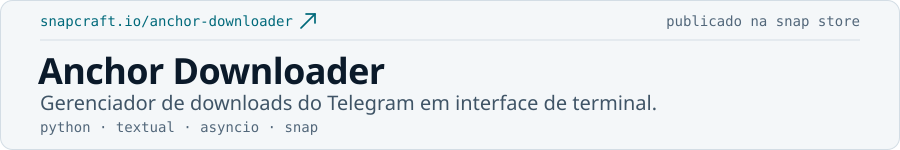
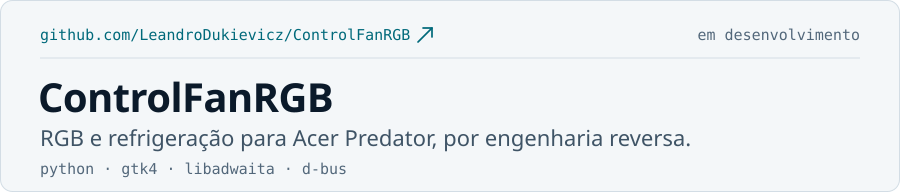
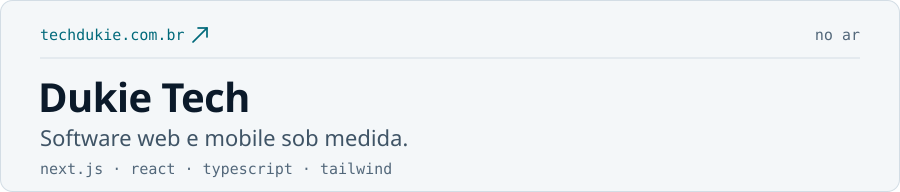

  <picture>
    <source media="(max-width: 500px) and (prefers-color-scheme: dark)" srcset="./assets/banner-m-dark.svg">
    <source media="(max-width: 500px)" srcset="./assets/banner-m-light.svg">
    <source media="(prefers-color-scheme: dark)" srcset="./assets/banner-dark.svg">
    
  </picture>

Desenvolvedor full stack em Maringá, Paraná. Escrevo o software inteiro, da interface ao servidor, e cuido do que vem depois dele: empacotamento, pipeline, deploy e publicação em loja.

## Trajetória

De 2018 a 2025 fui motorista profissional. Entre 2021 e 2024 cursei Sistemas para Internet na UniCesumar, estudando e programando. Desde maio de 2025 me dedico ao desenvolvimento, com alguns freelas pontuais.

## Alguns projetos publicados recentemente

<a href="https://snapcraft.io/anchor-downloader"><picture>
<source media="(max-width: 500px) and (prefers-color-scheme: dark)" srcset="./assets/card-anchor-m-dark.svg">
<source media="(max-width: 500px)" srcset="./assets/card-anchor-m-light.svg">
<source media="(prefers-color-scheme: dark)" srcset="./assets/card-anchor-dark.svg">

</picture></a>

Um broker próprio em socket `AF_UNIX` compartilha uma única conexão entre várias janelas, com limite de taxa global. Os downloads rodam em paralelo e retomam arquivos parciais. Empacotado em snap com confinamento strict e publicado por pipeline no GitHub Actions. Cerca de 4.200 linhas, com suíte de testes dedicada a path traversal e permissão de arquivo. [Código no GitHub](https://github.com/LeandroDukievicz/anchor-downloader).

<picture>
<source media="(max-width: 500px) and (prefers-color-scheme: dark)" srcset="./assets/rule-m-dark.svg">
<source media="(max-width: 500px)" srcset="./assets/rule-m-light.svg">
<source media="(prefers-color-scheme: dark)" srcset="./assets/rule-dark.svg">

</picture>

<a href="https://devsaderiva.com.br"><picture>
<source media="(max-width: 500px) and (prefers-color-scheme: dark)" srcset="./assets/card-deriva-m-dark.svg">
<source media="(max-width: 500px)" srcset="./assets/card-deriva-m-light.svg">
<source media="(prefers-color-scheme: dark)" srcset="./assets/card-deriva-dark.svg">

</picture></a>

Astro com renderização no servidor, painel de publicação separado e mídia em object storage. Nada vai ao ar sem passar pelo pipeline: lint, typecheck, testes, auditoria de segurança, SEO e checagem de link quebrado. [Código no GitHub](https://github.com/LeandroDukievicz/devs-a-deriva).

<picture>
<source media="(max-width: 500px) and (prefers-color-scheme: dark)" srcset="./assets/rule-m-dark.svg">
<source media="(max-width: 500px)" srcset="./assets/rule-m-light.svg">
<source media="(prefers-color-scheme: dark)" srcset="./assets/rule-dark.svg">

</picture>

O fabricante só entrega software para Windows. Para não precisar de dual boot só para controlar alguns detalhes da máquina, desenvolvi os dois do zero, por engenharia reversa.

<a href="https://github.com/LeandroDukievicz/ControlFanRGB"><picture>
<source media="(max-width: 500px) and (prefers-color-scheme: dark)" srcset="./assets/card-controlfanrgb-m-dark.svg">
<source media="(max-width: 500px)" srcset="./assets/card-controlfanrgb-m-light.svg">
<source media="(prefers-color-scheme: dark)" srcset="./assets/card-controlfanrgb-dark.svg">

</picture></a>

Aplicativo GTK4 com libadwaita e daemon em D-Bus, mais patch do módulo de kernel, para liberar no Linux o que a Acer só expõe pelo utilitário de Windows.

<picture>
<source media="(max-width: 500px) and (prefers-color-scheme: dark)" srcset="./assets/rule-m-dark.svg">
<source media="(max-width: 500px)" srcset="./assets/rule-m-light.svg">
<source media="(prefers-color-scheme: dark)" srcset="./assets/rule-dark.svg">

</picture>

<a href="https://github.com/LeandroDukievicz/mk-k68-lightsmart"><picture>
<source media="(max-width: 500px) and (prefers-color-scheme: dark)" srcset="./assets/card-mkk68-m-dark.svg">
<source media="(max-width: 500px)" srcset="./assets/card-mkk68-m-light.svg">
<source media="(prefers-color-scheme: dark)" srcset="./assets/card-mkk68-dark.svg">

</picture></a>

Protocolo HID do fabricante levantado por engenharia reversa do driver de Windows. Painel em PySide6 para a matriz de LED e para a iluminação, com as animações enviadas ao teclado.

<picture>
<source media="(max-width: 500px) and (prefers-color-scheme: dark)" srcset="./assets/rule-m-dark.svg">
<source media="(max-width: 500px)" srcset="./assets/rule-m-light.svg">
<source media="(prefers-color-scheme: dark)" srcset="./assets/rule-dark.svg">

</picture>

<a href="https://techdukie.com.br"><picture>
<source media="(max-width: 500px) and (prefers-color-scheme: dark)" srcset="./assets/card-dukietech-m-dark.svg">
<source media="(max-width: 500px)" srcset="./assets/card-dukietech-m-light.svg">
<source media="(prefers-color-scheme: dark)" srcset="./assets/card-dukietech-dark.svg">

</picture></a>

Minha operação de desenvolvimento para pequenas e médias empresas: levanto o problema, escrevo o sistema e cuido dele depois que entra no ar.

Outros projetos

**Cardápio e pedidos em PHP.** Selecionado entre os 10 finalistas do Desafio Nacional UniCesumar, avaliado entre milhares de projetos do país.

**Código aberto.** Contribuições em projetos de terceiros: [Rede-ENois/enois-frontend#102](https://github.com/Rede-ENois/enois-frontend/pull/102), [JafarAkhondali/acer-predator-turbo-and-rgb-keyboard-linux-module#308](https://github.com/JafarAkhondali/acer-predator-turbo-and-rgb-keyboard-linux-module/pull/308)

## Stack

Na ordem em que aparece no trabalho.

**Produto** 
`TypeScript` `React` `Next.js` `Astro` `JavaScript` `Python` `Node.js` `PHP` `SQL`

**Sistema e entrega** 
`Linux` `Docker` `CI/CD` `Git`

## Contato

| | |
|---|---|
| Portfólio | [devleandro.com.br](https://devleandro.com.br) |
| Blog | [devsaderiva.com.br](https://devsaderiva.com.br) |
| Dukie Tech | [techdukie.com.br](https://techdukie.com.br) |
| LinkedIn | [linkedin.com/in/leandrodukievicz](https://www.linkedin.com/in/leandrodukievicz) |

Maringá, PR · README em Markdown e SVG, sem widget de terceiros

